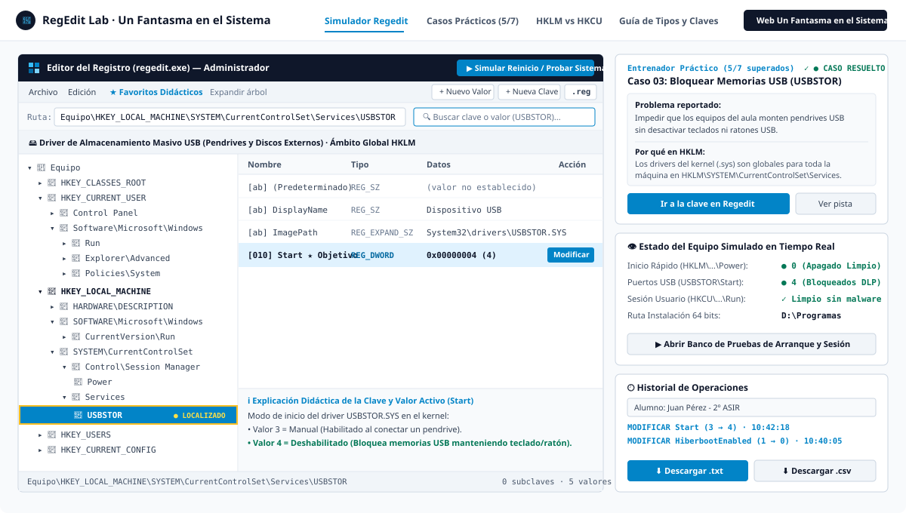
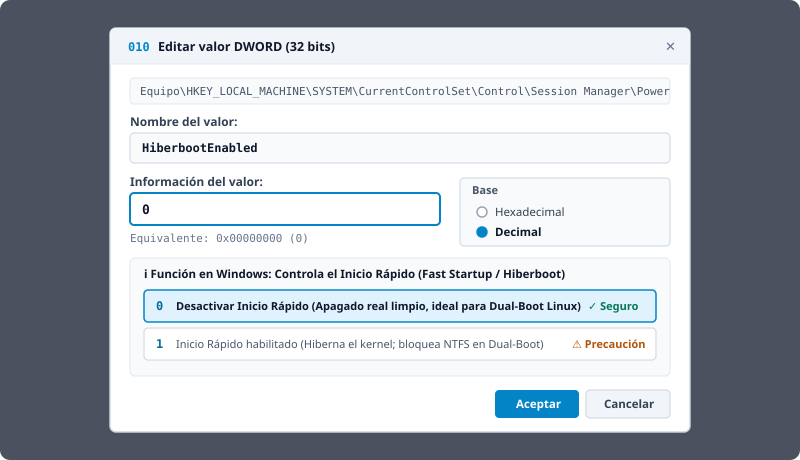
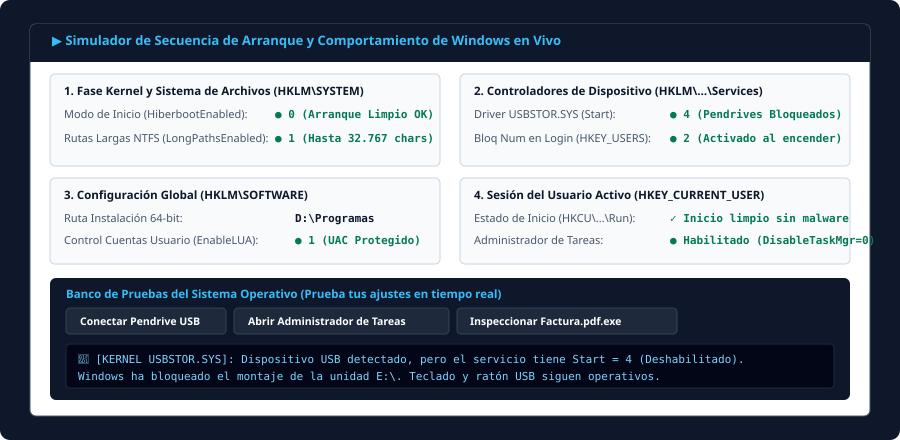

<div align="center">
  <a href="https://www.unfantasmaenelsistema.com/" target="_blank">
    
  </a>

  # Simulador Didáctico del Editor del Registro de Windows (`regedit.exe`)

  **Aprende administración de sistemas, seguridad, arranque y jerarquía `HKEY_LOCAL_MACHINE` vs `HKEY_CURRENT_USER` sin riesgo de dañar un sistema operativo real.**

   Desarrollado para **[Un Fantasma en el Sistema](https://www.unfantasmaenelsistema.com/)** · Listo para desplegar en **GitHub Pages**
</div>

---

## 📸 Capturas de Pantalla

### 1. Interfaz Principal del Simulador (`regedit.exe` + Entrenador Práctico + Estado en Vivo)


### 2. Edición Nativa de Valores (`REG_DWORD` / `REG_SZ`) con Conversión Hex/Decimal y Guía Didáctica


### 3. Simulador de Secuencia de Arranque y Banco de Pruebas del Sistema Operativo


---

## 🎯 Objetivo Pedagógico y Mecánica Didáctica

El **Registro de Windows** es uno de los componentes más críticos en los módulos de *Sistemas Operativos Monopuesto (SOM)*, *Implantación de Sistemas Operativos (ISO)* y *Administración de Sistemas Operativos (ASO)*. Sin embargo, practicar directamente sobre la máquina anfitriona conlleva riesgos de dejar el sistema inestable o sin arranque.

Este simulador ofrece una **réplica interactiva en árbol de `regedit.exe`** centrada en las claves reales más importantes de configuración de sistema, arranque, seguridad y perfiles de usuario, permitiendo que el alumnado:

1. **Comprenda la jerarquía `HKEY_LOCAL_MACHINE` (HKLM) frente a `HKEY_CURRENT_USER` (HKCU)**:
   - Identifique qué ajustes afectan al kernel, servicios y a **todos los usuarios** (`HKLM\SYSTEM`, `HKLM\SOFTWARE`) frente a los ajustes que residen en el archivo `NTUSER.DAT` de la sesión del usuario activo (`HKCU`).
   - Salte con un solo clic entre **claves espejo** (`Run`, `Policies\System`, `CurrentVersion`) y consulte las reglas de precedencia cuando existe conflicto entre máquina y usuario.
2. **Resuelva incidencias reales de administración y ciberseguridad**:
   - Cada clave y valor incorpora una explicación contextual y un verificador en tiempo real que evalúa automáticamente si la incidencia ha quedado resuelta.
3. **Verifique el impacto en un Banco de Pruebas de Arranque**:
   - Simule qué ocurre al encender el equipo, conectar un pendrive USB, abrir el Administrador de Tareas (`Ctrl+Shift+Esc`), inspeccionar un archivo sospechoso con doble extensión (`.pdf.exe`) o lanzar un instalador de 64 bits.
4. **Entregue sus ejercicios resueltos al profesor en `.txt` o `.csv`**:
   - El panel de **Historial de Operaciones** registra cronológicamente cada cambio realizado y permite introducir el nombre del alumno/grupo para descargar un informe completo en `.txt` o una hoja `.csv` compatible con Excel con la nota de los 7 casos prácticos y la auditoría de cambios.

---

## 🛠️ Los 7 Casos Prácticos Incluidos

| # | Caso Práctico | Rama Objetivo | Clave y Valor a Manipular | Solución Esperada |
| :-: | :--- | :---: | :--- | :--- |
| **01** | **Desactivar Inicio Rápido (Fast Startup) para Dual-Boot Linux/Windows** | `HKLM` | `HKLM\SYSTEM\CurrentControlSet\Control\Session Manager\Power` → `HiberbootEnabled` | `HiberbootEnabled = 0` (`REG_DWORD`) |
| **02** | **Neutralizar Malware en el Inicio de Sesión del Usuario** | `HKCU` vs `HKLM` | `HKCU\Software\Microsoft\Windows\CurrentVersion\Run` → `CryptoMinerUpdater` | Eliminar `CryptoMinerUpdater` conservando `SecurityHealth` en `HKLM` |
| **03** | **Bloquear Dispositivos de Almacenamiento Masivo USB (DLP)** | `HKLM` | `HKLM\SYSTEM\CurrentControlSet\Services\USBSTOR` → `Start` | `Start = 4` (Deshabilitado) |
| **04** | **Cambiar la Ruta por Defecto de Instalación de Programas (64 bits)** | `HKLM` | `HKLM\SOFTWARE\Microsoft\Windows\CurrentVersion` → `ProgramFilesDir` | `ProgramFilesDir = D:\Programas` (`REG_SZ`) |
| **05** | **Restaurar el Administrador de Tareas Bloqueado por Directiva** | `HKCU` | `HKCU\Software\Microsoft\Windows\CurrentVersion\Policies\System` → `DisableTaskMgr` | `DisableTaskMgr = 0` (o eliminar valor) |
| **06** | **Mostrar Extensiones de Archivo para Prevenir Phishing (`.pdf.exe`)** | `HKCU` | `HKCU\Software\Microsoft\Windows\CurrentVersion\Explorer\Advanced` → `HideFileExt` | `HideFileExt = 0` (`REG_DWORD`) |
| **07** | **Habilitar Rutas Largas NTFS (>260 caracteres) y Bloq Num en Login** | `HKLM` + `HKU` | `HKLM\...\Control\FileSystem\LongPathsEnabled` y `HKU\.DEFAULT\Control Panel\Keyboard\InitialKeyboardIndicators` | `LongPathsEnabled = 1` + `InitialKeyboardIndicators = 2` |

---

## ✨ Funcionalidades Técnicas Destacadas

- **Buscador instantáneo con resaltado de pulso de 3 segundos**: Busca por nombre de clave, nombre de valor o datos; al seleccionar un resultado (o pulsar `Enter`), el árbol expande la ruta automáticamente, centra la clave en pantalla (`scrollIntoView`) y la resalta durante 3 segundos con una animación de pulso.
- **Exportación de scripts `.reg` reales**: Cualquier rama del árbol puede exportarse con sintaxis oficial `Windows Registry Editor Version 5.00` para descargarse como archivo `.reg` o copiarse al portapapeles.
- **Creación y edición de tipos de datos reales**: Soporta `REG_SZ`, `REG_DWORD`, `REG_QWORD`, `REG_EXPAND_SZ`, `REG_MULTI_SZ` y `REG_BINARY`, con cambio dinámico de base Decimal / Hexadecimal.
- **Persistencia local (`localStorage`) y restauración**: El estado del registro, el nombre del alumno y el historial de operaciones se conservan aunque se recargue la página, con opción de restablecer el registro de fábrica en cualquier momento.

---

## 🚀 Instalación Local y Despliegue en GitHub Pages

### Ejecución en entorno local

```bash
# 1. Clonar el repositorio
git clone https://github.com/TU_USUARIO/TU_REPOSITORIO.git
cd TU_REPOSITORIO

# 2. Instalar dependencias
npm install

# 3. Iniciar servidor de desarrollo (http://localhost:3000)
npm run dev

# 4. Generar compilación estática de producción en /dist
npm run build
```

### Publicación automática en GitHub Pages (Ya preconfigurada)

El proyecto ya incluye:
1. `base: './'` en `vite.config.ts` para que todas las rutas y recursos funcionen tanto en un dominio raíz como en una subcarpeta `https://tu-usuario.github.io/nombre-repo/`.
2. El flujo de trabajo de GitHub Actions en `.github/workflows/deploy.yml`.

**Pasos para activarlo en tu repositorio de GitHub:**
1. Sube todo el código a la rama `main` de tu repositorio en GitHub.
2. En GitHub, entra en **Settings → Pages**.
3. En la sección **Build and deployment → Source**, selecciona **GitHub Actions**.
4. ¡Listo! En menos de 1 minuto la pestaña **Actions** compilará y publicará automáticamente la aplicación en tu URL de GitHub Pages.

---

## 🌐 Autoría y Enlaces

Proyecto educativo creado para **[Un Fantasma en el Sistema](https://www.unfantasmaenelsistema.com/)**.
