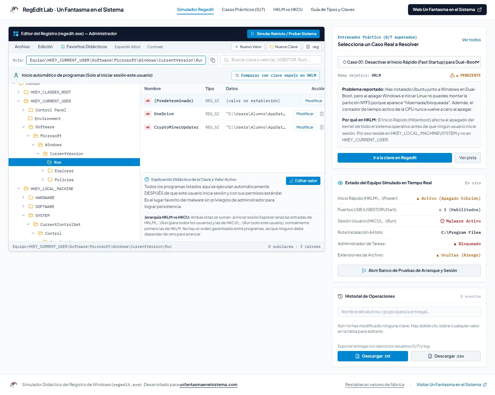
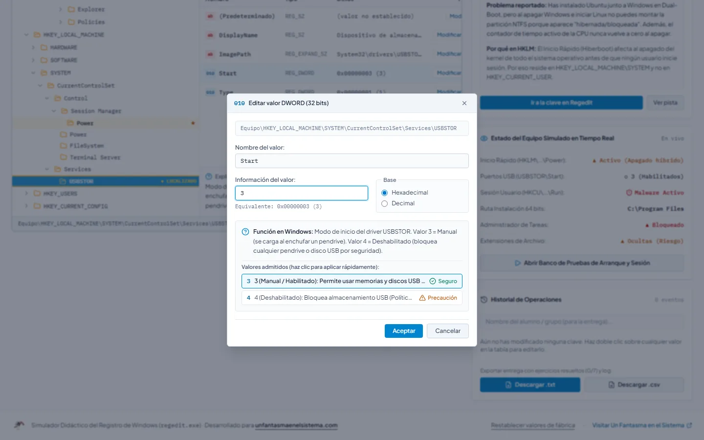
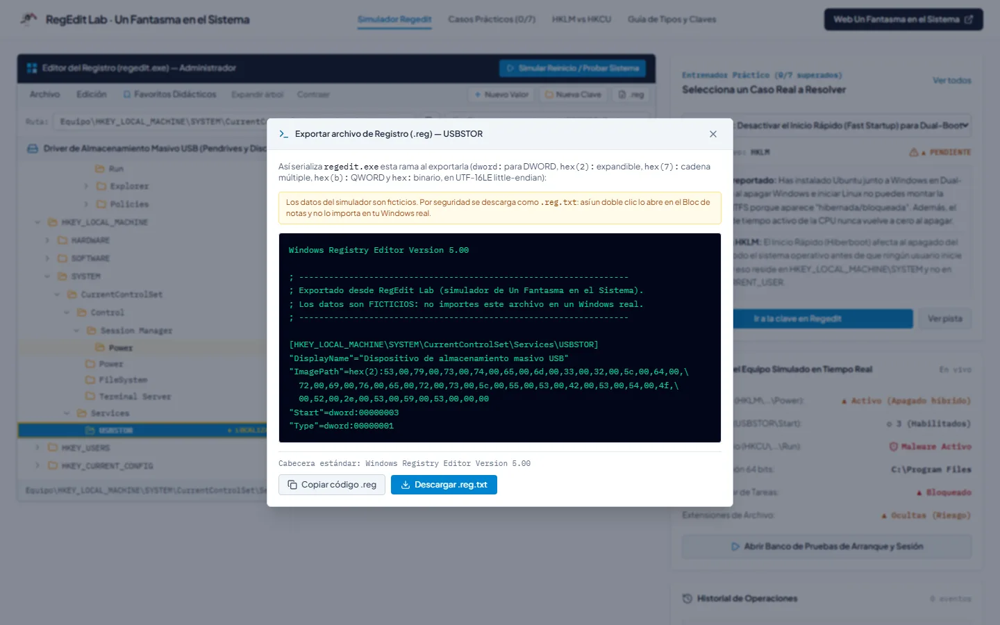
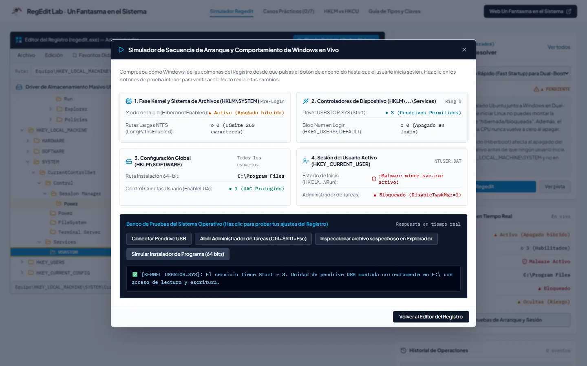

<p align="center">
  <a href="https://www.unfantasmaenelsistema.com"></a>
</p>

<h1 align="center">RegEdit Lab</h1>

<p align="center">
  <b>Simulador didáctico del Editor del Registro de Windows (<code>regedit.exe</code>) en el navegador</b><br>
  HKLM frente a HKCU · Colmenas y claves espejo · DWORD, QWORD, expandibles y binarios · Exportación .reg real · 7 casos prácticos con corrección automática
</p>

<p align="center">
  <a href="https://unfantasmaenelsistema.github.io/RegeditLab/"><b>▶ Abrir el simulador</b></a> ·
  <a href="#qué-hace">Qué hace</a> ·
  <a href="#casos-prácticos">Casos prácticos</a> ·
  <a href="#qué-modela-y-qué-no">Qué modela</a> ·
  <a href="#desarrollo">Desarrollo</a> ·
  <a href="https://www.unfantasmaenelsistema.com">unfantasmaenelsistema.com</a> ·
  <a href="LICENSE">MIT</a>
</p>

<p align="center">
  
  
  
  
</p>

<p align="center">
  
</p>

Una réplica de `regedit.exe` con las claves que de verdad se tocan en clase: arranque y energía, servicios y controladores, programas de inicio, directivas, Explorador y perfiles de usuario. Cada clave y cada valor explican para qué sirven, a qué ámbito pertenecen (máquina o usuario) y qué pasa si los cambias, y un banco de pruebas enseña el efecto en el equipo simulado. Se practica sin riesgo de dejar un Windows real sin arrancar.

> [!WARNING]
> Es un simulador: los datos son ficticios y nada de lo que hagas aquí toca tu sistema. Por eso la exportación se descarga como `.reg.txt`; un `.reg` con estos datos (por ejemplo `DisableTaskMgr=1`) se importaría a tu Windows con un simple doble clic.

## Qué hace

- **Árbol de las cinco ramas** (`HKCR`, `HKCU`, `HKLM`, `HKU`, `HKCC`) con su ámbito explicado y un botón para saltar a la **clave espejo** (`Run`, `Policies\System`, `CurrentVersion`) y comparar qué gana cuando existen en las dos.
- **Barra de direcciones como la de regedit**: admite `HKLM\SYSTEM\...`, el nombre completo de la rama, el prefijo `Equipo\` o `Computer\` y avisa si la clave no existe. Buscador de claves, valores y datos con resaltado en el árbol.
- **Edición fiel de los tipos**: los DWORD y QWORD se abren en hexadecimal, cambian de base sin perder el número y rechazan valores fuera de rango (32 o 64 bits, sin truncar); los binarios se editan por bytes y las cadenas múltiples por líneas. No se pueden repetir nombres de valor ni crear claves en la raíz de `HKLM` o `HKU`, y borrar pide confirmación, como en Windows.
- **Exportación con la sintaxis real**: `dword:`, `hex(2):` para cadenas expandibles, `hex(7):` para cadenas múltiples, `hex(b):` para QWORD y `hex:` para binarios, en UTF-16LE y con el ajuste de línea de regedit.
- **Banco de pruebas**: conectar un pendrive, abrir el Administrador de tareas, mirar un `Nomina_Mayo.pdf.exe` en el Explorador o lanzar un instalador muestra el efecto de lo que has cambiado.
- **Entrega para el profesor**: historial de operaciones con nombre del alumno y descarga en `.txt` o `.csv` (con BOM para Excel) con la nota de los 7 casos.
- El estado se guarda en el navegador y se puede restaurar de fábrica en cualquier momento.

<p align="center">
  
</p>

## Casos prácticos

| # | Caso | Rama | Solución |
| :-: | :-- | :-: | :-- |
| 01 | Desactivar el Inicio Rápido para un arranque dual con Linux | `HKLM` | `Session Manager\Power\HiberbootEnabled = 0` (también vale desactivar la hibernación entera) |
| 02 | Quitar un minero del inicio de sesión del usuario | `HKCU` vs `HKLM` | Borrar `CryptoMinerUpdater` de `HKCU\...\Run` sin tocar `SecurityHealth` |
| 03 | Bloquear el almacenamiento USB sin perder teclado ni ratón | `HKLM` | `Services\USBSTOR\Start = 4` |
| 04 | Localizar la ruta de instalación de programas de 64 bits | `HKLM` | `ProgramFilesDir = D:\Programas` (con aviso: Microsoft no lo admite en un equipo real) |
| 05 | Recuperar el Administrador de tareas bloqueado por directiva | `HKCU` | `Policies\System\DisableTaskMgr = 0` o eliminarlo |
| 06 | Mostrar las extensiones para destapar un `.pdf.exe` | `HKCU` | `Explorer\Advanced\HideFileExt = 0` |
| 07 | Rutas largas NTFS y Bloq Num en la pantalla de inicio | `HKLM` + `HKU` | `LongPathsEnabled = 1` y `HKU\.DEFAULT\...\InitialKeyboardIndicators = 2` |

La corrección mira el efecto, no el truco: cambiarle el nombre al valor del minero o moverlo a `HKLM\...\Run` no resuelve el caso 02, porque Windows ejecuta la ruta, no el nombre. Las pruebas automáticas aplican las soluciones de las pistas en una misma sesión y comprueban que los 7 casos quedan resueltos.

<p align="center">
  
</p>

## Qué modela y qué no

- `HiberbootEnabled` vive en `Control\Session Manager\Power` y `HibernateEnabled` en `Control\Power`. El Inicio Rápido depende de la hibernación, así que `HibernateEnabled = 0` (lo que hace `powercfg /h off`) también lo desactiva.
- Cualquier valor distinto de 0 en `DisableTaskMgr` bloquea el Administrador de tareas; sin `HideFileExt`, Windows oculta las extensiones conocidas.
- `LongPathsEnabled` solo lo aprovechan las aplicaciones declaradas `longPathAware`; el Explorador mantiene el límite de 260 caracteres y Git necesita además `core.longpaths`.
- `EnableLUA = 0` (tras reiniciar) hace que los administradores ejecuten todo con el token completo y que las apps de la Microsoft Store dejen de abrirse.
- El árbol contiene una selección de claves reales, no el registro completo. No hay permisos por clave ni importación de `.reg`.

<p align="center">
  
</p>

<p align="center">
  
</p>

## Privacidad

Todo se ejecuta en el navegador, sin servidor ni cuentas. El registro simulado, el historial y el nombre del alumno se guardan en el almacenamiento local del navegador. Las fuentes van incluidas en la web y una política CSP estricta impide cargar código o estilos de terceros.

## Desarrollo

Requisitos: Node.js 20 o superior.

```bash
git clone https://github.com/unfantasmaenelsistema/RegeditLab.git
cd RegeditLab
npm ci
npm run dev      # http://localhost:3000
npm test         # pruebas del motor y de los casos (Vitest)
npm run lint     # comprobación de tipos
npm run build    # versión estática en dist/
```

El workflow `.github/workflows/deploy.yml` comprueba tipos, pasa las pruebas, compila y publica `dist/` en GitHub Pages en cada push a `main`.

```text
src/
├── engine/registryEngine.ts   # tipos de datos, barra de direcciones y exportación .reg
├── data/initialRegistry.ts    # árbol de claves y los 7 casos con su corrección
├── components/                # diálogos de edición, exportación y banco de pruebas
└── **/*.test.ts               # pruebas (Vitest)
```

## Cambios

### 2.0.0 (2026-11-02)

- Publicado en la organización con despliegue en GitHub Pages: el workflow original no podía funcionar (`npm install` fallaba por un conflicto de versiones de `esbuild` y la caché de npm no tenía lockfile).
- **Exportación**: las cadenas expandibles, múltiples, QWORD y binarias salían como cadenas normales (al importarlas se convertían en `REG_SZ`). Ahora usan `hex(2)`, `hex(7)`, `hex(b)` y `hex:` en UTF-16LE con el ajuste de línea de regedit. La descarga pasa a `.reg.txt` con aviso, porque el `.reg` con datos ficticios se importaba al Windows real con doble clic.
- **Caso 02**: renombrar el valor del minero lo daba por resuelto aunque siguiera arrancando. Ahora se comprueba la ruta en las dos listas `Run`.
- **Edición**: `parseInt` aceptaba `12abc` como 12 y los valores grandes se truncaban a 32 bits sin aviso, también los QWORD. Ahora hay validación y 64 bits reales; el diálogo abre en hexadecimal como regedit. Se impiden nombres repetidos y las claves en la raíz de `HKLM`/`HKU`; borrar y restaurar piden confirmación.
- **Barra de direcciones**: solo aceptaba la ruta exacta con `Equipo\`, así que las rutas de las pistas (`HKLM\...`) no hacían nada. Ahora admite abreviaturas y avisa del error.
- **Datos técnicos**: `HibernateEnabled` estaba en la clave equivocada; `ProgramFilesDir` se presentaba como un cambio recomendable cuando Microsoft no lo admite; `EnableLUA`, `LongPathsEnabled`, el orden de `Run`, el nombre de la CPU y la ruta de `RtkAudUService` se corrigen. `REG_SZ` no es de «longitud fija».
- **Interfaz**: la cabecera y las tarjetas desbordaban en móvil; un estado guardado dañado dejaba la app en blanco. Fuentes incluidas en la web en lugar de Google Fonts, CSP estricta, capturas reales en lugar de dibujos SVG, fuera dependencias de Gemini y Express que no se usaban, y 27 pruebas automáticas.

### 1.0.0

- Versión inicial generada con Google AI Studio.

## Créditos y licencia

Creado por **[Un Fantasma en el Sistema](https://www.unfantasmaenelsistema.com)** para los módulos de sistemas operativos y administración de sistemas de FP. Fuentes Plus Jakarta Sans e IBM Plex Mono (SIL Open Font License) vía Fontsource; iconos de Lucide (ISC).

Código bajo licencia [MIT](LICENSE).
